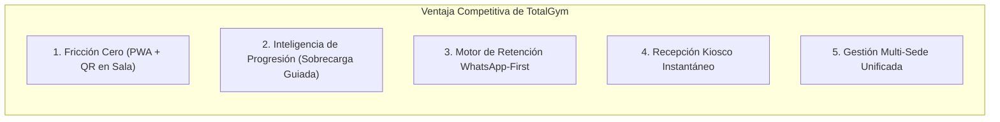
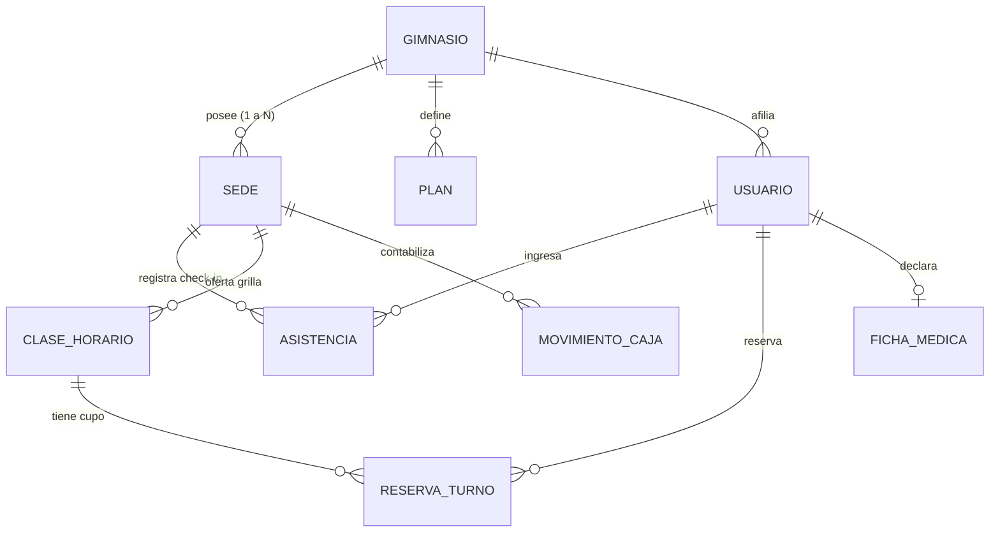

# Estudio de Mercado y Análisis de Ventaja Competitiva — TotalGym / Meraki SaaS

> **Fecha:** Noviembre 2026  
> **Proyecto:** TotalGym (Centro de Entrenamiento Meraki)  
> **Enfoque:** Apps de Entrenamiento Fitness (B2C) y Plataformas SaaS de Gestión para Gimnasios (B2B)

---

## Índice

1. [Resumen Ejecutivo y Diagnóstico del Proyecto Actual](#1-resumen-ejecutivo-y-diagnóstico-del-proyecto-actual)
2. [Panorama del Mercado: Categorías y Competidores Clave](#2-panorama-del-mercado-categorías-y-competidores-clave)
3. [Matriz Comparativa de Funcionalidades](#3-matriz-comparativa-de-funcionalidades)
4. [Brechas Funcionales: Qué ofrece el mercado que hoy NO tiene el proyecto](#4-brechas-funcionales-qué-ofrece-el-mercado-que-hoy-no-tiene-el-proyecto)
5. [Propuestas de Mejora para Lograr una Ventaja Competitiva Real](#5-propuestas-de-mejora-para-lograr-una-ventaja-competitiva-real)
6. [Arquitectura de Datos Sugerida para Evolucionar a SaaS Multi-Sede](#6-arquitectura-de-datos-sugerida-para-evolucionar-a-saas-multi-sede)
7. [Hoja de Ruta Estratégica (Roadmap Priorizado)](#7-hoja-de-ruta-estratégica-roadmap-priorizado)

---

## 1. Resumen Ejecutivo y Diagnóstico del Proyecto Actual

Actualmente, el mercado de software para gimnasios sufre una **fuerte fragmentación**:
- Los **sistemas de gestión administrativa (ERP)** son excelentes controlando pagos, turnos y molinetes, pero ofrecen una experiencia pobre, anticuada o inexistente para el socio mientras entrena en la sala de musculación.
- Las **aplicaciones de seguimiento de entrenamiento (Workout Trackers)** tienen interfaces brillantes para anotar series, pesos y ver gráficos de progreso, pero están desconectadas de la administración del gimnasio (no saben si el socio pagó la cuota, qué plan contrató ni qué plantilla le asignó el profesor de turno).

### Lo que ya tiene el proyecto (Fortalezas actuales)
A partir de la auditoría del código actual ([`prisma/schema.prisma`](file:///Users/juan.gaya/gym/prisma/schema.prisma), [`src/app/`](file:///Users/juan.gaya/gym/src/app) y [`docs/specs.md`](file:///Users/juan.gaya/gym/docs/specs.md)), el proyecto cuenta con una base técnica y funcional muy superior al promedio de sistemas locales:

- **Stack Tecnológico de Última Generación:** Next.js 16 (App Router), React 19, TypeScript estricto, Prisma 7 con MariaDB/MySQL y diseño _SaaS Mobile High-Tech Boutique_ con soporte nativo Claro/Oscuro.
- **PWA Instalable Multiplataforma:** Soporte completo en Android, iOS y Desktop con `Service Worker`, manifiesto dinámico e íconos adaptativos (`maskable`).
- **Motor Flexible de Planes y Rutinas Multi-Día:**
  - Planes de 1 a 7 días por semana ([`Plan`](file:///Users/juan.gaya/gym/prisma/schema.prisma#L25-L39)).
  - Plantillas de rutinas asociadas a planes ([`PlanRutinaTemplate`](file:///Users/juan.gaya/gym/prisma/schema.prisma#L146-L164)) para asignar un esquema completo a un socio nuevo en segundos.
  - Agrupación de ejercicios (`grupoNumero` para biseries, triseries o circuitos), orden, series, rango de repeticiones, tiempos de descanso y notas técnicas.
- **Experiencia del Socio en Sala de Entrenamiento ([`/mi-rutina`](file:///Users/juan.gaya/gym/src/app/mi-rutina/page.tsx)):**
  - Visualización de la rutina del día, temporizador de descanso flotante ([`TimerFlotante.tsx`](file:///Users/juan.gaya/gym/src/app/mi-rutina/TimerFlotante.tsx)) y progreso en pantalla de bloqueo ([`LockScreenProgress.tsx`](file:///Users/juan.gaya/gym/src/app/mi-rutina/LockScreenProgress.tsx)).
  - Registro de cargas reales, RPE (esfuerzo percibido 1-10) y gráficos históricos de evolución por ejercicio ([`HistorialGraficoModal.tsx`](file:///Users/juan.gaya/gym/src/app/mi-rutina/HistorialGraficoModal.tsx)).
- **Seguimiento Antropométrico Personalizable ([`/mis-medidas`](file:///Users/juan.gaya/gym/src/app/mis-medidas/page.tsx)):**
  - Registro de medidas estándar (peso, cintura, bíceps, etc.) y creación de métricas personalizadas con íconos, colores y gráficos de evolución.
- **Módulo Económico y Pasarela Local ([`/admin/economia`](file:///Users/juan.gaya/gym/src/app/admin/economia/page.tsx)):**
  - Control mensual de cuotas pagas/impagas, exportación de reportes ([`exportUtils.ts`](file:///Users/juan.gaya/gym/src/app/admin/economia/exportUtils.ts)) e integración con **Mercado Pago** ([`src/lib/mercadopago.ts`](file:///Users/juan.gaya/gym/src/lib/mercadopago.ts)).

---

## 2. Panorama del Mercado: Categorías y Competidores Clave

Para posicionar el proyecto estratégicamente, analizamos los tres segmentos que hoy compiten por los gimnasios y centros de entrenamiento:

### Segmento A: SaaS de Gestión y Turnos en Latinoamérica y España (Competencia Directa B2B)
| Plataforma | Foco Principal | Puntos Fuertes | Puntos Débiles |
| :--- | :--- | :--- | :--- |
| **Crossfy** *(Argentina/LatAm)* | Boxes de CrossFit, Funcional y Gimnasios | Muy adoptado en Argentina; reserva de turnos por clase, pagos con Mercado Pago, control de acceso por QR/DNI, comunidad del box. | El seguimiento de rutinas de musculación e hipertrofia personalizada es básico (pensado para WODs grupales del día). |
| **WodBuster** *(España/LatAm)* | Boxes, Centros Boutique y Funcional | Excelente gestión de cupos, listas de espera automáticas, penalización por ausencias y timers para TV del gimnasio. | Interfaz recargada; poco amigable para gimnasios de musculación tradicional con rutinas individuales por socio. |
| **MisActividades / Fitco** *(LatAm)* | Gimnasios medianos, estudios de Pilates/Yoga | Control de caja, facturación local, recordatorios automáticos de vencimiento, control de acceso con molinetes. | No tienen un módulo profundo de prescripción de entrenamiento, biseries, RPE ni evolución antropométrica. |
| **Trainingym** *(España/Global)* | Grandes cadenas y gimnasios medianos | Todo-en-uno: app para socios, más de 1.500 ejercicios 3D, integración con balanzas de bioimpedancia, encuestas NPS y campañas de retención. | Costo mensual elevado para gimnasios independientes; curva de aprendizaje compleja para los entrenadores. |

### Segmento B: Plataformas Globales de Club Management
| Plataforma | Foco Principal | Puntos Fuertes | Puntos Débiles |
| :--- | :--- | :--- | :--- |
| **Mindbody / Glofox** | Estudios boutique internacionales | Ecosistema de marketing, CRM avanzado, marketplace de descubrimiento para atraer nuevos clientes, cobros recurrentes. | Precios prohibitivos en dólares (USD 150 a 500+/mes) y falta de integración nativa con medios de pago locales como Mercado Pago o ARCA/AFIP. |
| **Virtuagym / Gymdesk** | Gimnasios y estudios de entrenamiento | Buena combinación entre control de membresías, entrenamientos y nutrición. | Poco adaptados a la realidad operativa de Latinoamérica (DNI, cuotas en efectivo/transferencia con ajuste mensual por inflación). |

### Segmento C: Apps Especializadas en Entrenamiento y Coaching (Referentes en UX)
| Plataforma | Foco Principal | Puntos Fuertes | Puntos Débiles |
| :--- | :--- | :--- | :--- |
| **Hevy / Strong** | Usuarios de gimnasio (B2C) y Hevy Coach | **La mejor UX del mercado** durante el entrenamiento: calculadora de discos, detección de récords (PRs), gráficos de 1RM, mapa muscular de fatiga. | No gestionan un gimnasio físico (no manejan planes por días semanales, cuotas, caja, ni control de acceso en recepción). |
| **Harbiz / Trainerize** | Entrenadores personales y coaching híbrido | Chat interno entrenador-alumno, seguimiento de hábitos diarios (pasos, agua, sueño), check-ins con fotos comparativas (frente/perfil/espalda). | Pensadas para entrenadores 1-a-1 online; no escalan bien cuando un gimnasio tiene 300+ socios rotando en 3 sucursales. |

---

## 3. Matriz Comparativa de Funcionalidades

Comparación directa entre el estado actual de **TotalGym** y los referentes de cada categoría:

| Funcionalidad / Módulo | TotalGym (Actual) | Crossfy / WodBuster | Trainingym / Virtuagym | Hevy / Harbiz |
| :--- | :---: | :---: | :---: | :---: |
| **Instalación sin App Store (PWA ligera)** | ✅ Sí | ❌ App nativa pesada | ❌ App nativa pesada | ❌ App nativa |
| **ABM de Planes por días/semana (1 a 7)** | ✅ Sí | ✅ Sí | ✅ Sí | ❌ No |
| **Plantillas de Rutinas vinculadas a Planes** | ✅ Sí | ⚠️ Parcial (WOD diario) | ✅ Sí | ✅ Sí |
| **Biseries / Superseries (`grupoNumero`)** | ✅ Sí | ❌ No | ✅ Sí | ✅ Sí |
| **Registro de series, peso, RPE y gráficos** | ✅ Sí | ⚠️ Básico | ✅ Sí | ✅ Excelente |
| **Temporizador flotante + LockScreen** | ✅ Sí | ⚠️ Solo timer básico | ✅ Sí | ✅ Sí |
| **Medidas corporales + Tipos personalizados** | ✅ Sí | ❌ No | ✅ Sí (Bioimpedancia) | ✅ Sí |
| **Cobros con Mercado Pago + Efectivo/Transf.** | ✅ Sí | ✅ Sí | ⚠️ Limitado en LatAm | ❌ No (Stripe) |
| **Control de Acceso Recepción (QR / DNI)** | ❌ Falta | ✅ Sí | ✅ Sí | ❌ No |
| **Reserva de Turnos / Clases con Cupo** | ❌ Falta | ✅ Excelente | ✅ Sí | ❌ No |
| **Multi-Sede / Multi-Sucursal (ej. 3 sedes)** | ⚠️ Solo en Landing | ✅ Sí | ✅ Sí | ❌ No |
| **Alertas automáticas por WhatsApp / Push** | ❌ Falta | ✅ Sí | ✅ Sí | ✅ Push |
| **Control de Apto Médico y vencimientos** | ❌ Falta | ✅ Sí | ✅ Sí | ❌ No |
| **Detección de Récords (PRs) y 1RM estimado** | ❌ Falta | ⚠️ Básico | ❌ No | ✅ Excelente |
| **Fotos de progreso comparativas (Antes/Después)**| ❌ Falta | ❌ No | ❌ No | ✅ Sí |
| **Gestión de Egresos / Sueldos / Caja Chica** | ❌ Solo ingresos | ✅ Sí | ✅ Sí | ❌ No |

---

## 4. Brechas Funcionales: Qué ofrece el mercado que hoy NO tiene el proyecto

Al contrastar el esquema actual de base de datos ([`prisma/schema.prisma`](file:///Users/juan.gaya/gym/prisma/schema.prisma)) y las vistas de la aplicación con las exigencias reales de un centro como **Meraki (con 3 direcciones)** y el mercado SaaS, se detectan **8 brechas críticas**:

### 4.1. Control de Acceso en Recepción y Validación de Cuota / Días del Plan
- **Situación actual:** El modelo [`Plan`](file:///Users/juan.gaya/gym/prisma/schema.prisma#L25-L39) define `diasPorSemana` (ej. 3 días/semana) y el modelo [`Pago`](file:///Users/juan.gaya/gym/prisma/schema.prisma#L313-L333) registra el pago mensual (`mes`, `anio`), pero no existe un flujo de **Check-in en Recepción**.
- **Lo que ofrece el mercado:** Una pantalla modo "Kiosco" en la recepción (o un QR pegado en el mostrador que el socio escanea con su celular) que valida en tiempo real:
  1. Si el socio tiene la cuota del mes paga o vencida.
  2. Cuántas asistencias lleva esta semana respecto a su plan (ej. *"Asistencia 2 de 3 esta semana"*).
  3. Si tiene el **Apto Médico** vigente.
  4. Emite una señal visual/sonora verde (habilitado) o roja/amarilla (cuota pendiente / límite de días alcanzado).

### 4.2. Soporte Real Multi-Sede y Multi-Tenant en Base de Datos
- **Situación actual:** La landing page ([`src/app/page.tsx`](file:///Users/juan.gaya/gym/src/app/page.tsx)) promociona las **3 sedes de Meraki**, y en [`prisma/schema.prisma`](file:///Users/juan.gaya/gym/prisma/schema.prisma#L16-L20) existe el rol `SUPERADMIN`, pero ninguna tabla (`Usuario`, `Plan`, `Pago`, `SesionEntrenamiento`) tiene relación con una entidad `Sede` o `Gimnasio`.
- **Lo que ofrece el mercado:**
  - Saber a qué sucursal pertenece cada socio (o si su plan es "Pase Libre Multi-Sede").
  - Filtrar la recaudación económica ([`/admin/economia`](file:///Users/juan.gaya/gym/src/app/admin/economia/page.tsx)) por cada una de las 3 direcciones de Meraki.
  - Si se comercializa como **SaaS a otros gimnasios**, aislar por completo los datos de cada gimnasio (`gimnasioId` / `tenantId`) con su propio logo, colores, precios y token de Mercado Pago.

### 4.3. Reserva de Turnos, Clases Grupales y Control de Cupos
- **Situación actual:** El calendario ([`/calendario`](file:///Users/juan.gaya/gym/src/app/calendario/page.tsx)) muestra el historial de entrenamientos realizados, pero no permite **reservar un turno futuro**.
- **Lo que ofrece el mercado:** En centros de entrenamiento funcional, CrossFit, boxeo o musculación por turnos, el socio reserva su lugar en una franja horaria (ej. *Lunes 19:00 hs — Funcional Sede Centro — Cupo: 18/20*). Si el cupo se llena, el socio entra en **Lista de Espera** y, si alguien cancela con más de 2 horas de anticipación, el lugar se asigna automáticamente al siguiente en la fila.

### 4.4. Automatización de Cobranzas, Vencimientos por Fecha Real y Egresos
- **Situación actual:** El modelo [`Pago`](file:///Users/juan.gaya/gym/prisma/schema.prisma#L313-L333) funciona por mes calendario (`mes: 1..12`, `anio: 2026`). Sin embargo, en la mayoría de los gimnasios los socios pagan del 1 al 10 o tienen vencimientos móviles cada 30 días desde su fecha de inscripción (`fechaVencimientoCuota`).
- **Lo que falta frente al mercado:**
  - **Estados de membresía:** *Activa*, *Por vencer (faltan 3 días)*, *Vencida / En mora*, *Congelada (por vacaciones o lesión)*.
  - **Gastos y Flujo de Caja Neto:** En `/admin/economia` hoy solo se registran ingresos por cuotas. Falta una tabla `MovimientoCaja` o `Gasto` (alquiler de cada sede, sueldos de profesores, luz, mantenimiento de máquinas) y venta de productos (agua, suplementos, merchandising) para conocer la **rentabilidad neta real** del gimnasio.
  - **Actualización masiva de precios:** En economías con inflación, los gimnasios necesitan un botón para *"Actualizar todos los planes un +X% a partir del próximo mes"* y notificar a los socios.

### 4.5. Retención Activa y Comunicación Automatizada (Anti-Abandono / Churn)
- **Situación actual:** No hay envíos automáticos por WhatsApp ni notificaciones Web Push desde el Service Worker.
- **Lo que ofrece el mercado:** El mayor problema de un gimnasio no es inscribir socios, sino que abandonan al segundo o tercer mes. Los líderes del mercado incluyen un **Radar de Riesgo de Abandono**: si un socio con cuota activa lleva **10 días sin registrar una `SesionEntrenamiento`**, el sistema alerta al administrador con un botón directo a WhatsApp: *"Hola Juan, hace 10 días no te vemos por Meraki, ¿todo bien con tu rutina?"*.

### 4.6. Gamificación y Analítica Deportiva en la Sala de Entrenamiento
- **Situación actual:** El socio puede anotar su peso, series, repeticiones y RPE, y ver la línea temporal del peso levantado.
- **Lo que ofrecen las apps líderes (Hevy / Strong / Fitbod):**
  - **Cálculo automático de 1RM (Una Repetición Máxima)** mediante la fórmula de Epley o Brzycki:
    $$\text{1RM} = \text{Peso} \times \left(1 + \frac{\text{Repeticiones}}{30}\right)$$
  - **Celebración de Récords Personales (PRs):** Cuando el usuario supera su peso máximo histórico o su volumen total ($\text{Series} \times \text{Repeticiones} \times \text{Peso}$) en un ejercicio, aparece una insignia de trofeo dorada al finalizar la sesión.
  - **Mapa Anatómico de Fatiga / Volumen Semanal:** Como `Ejercicio` ya tiene el campo `grupoMuscular`, se puede mostrar una silueta humana indicando qué músculos trabajó esta semana y cuáles le faltan.
  - **Fotos de Progreso Comparativas (Antes y Después):** Junto con [`MedidaCorporal`](file:///Users/juan.gaya/gym/prisma/schema.prisma#L340-L358), permitir subir fotos privadas de progreso con visor deslizante (*slider before/after*) entre dos fechas.

### 4.7. Gestión de Apto Médico y Ficha de Salud (Anamnesis)
- **Situación actual:** El modelo [`Usuario`](file:///Users/juan.gaya/gym/prisma/schema.prisma#L44-L87) solo almacena datos de contacto y fecha de nacimiento.
- **Lo que ofrece el mercado (y exigen las normativas municipales):**
  - Fecha de presentación y vencimiento anual del **Certificado de Aptitud Física** (con subida de foto/PDF del certificado).
  - **Ficha médica rápida (Alertas para el profesor):** Lesiones previas (ej. *"Hernia lumbar L5-S1"*, *"Tendinitis de hombro"*), patologías, contacto de emergencia y grupo sanguíneo, visible para el entrenador cuando le arma o edita la rutina en [`AsignarRutinaModal.tsx`](file:///Users/juan.gaya/gym/src/app/admin/usuarios/AsignarRutinaModal.tsx).

---

## 5. Propuestas de Mejora para Lograr una Ventaja Competitiva Real

Para que **TotalGym** no sea simplemente "otro software más para gimnasios", sino que supere tanto a **Crossfy** como a las planillas de Excel/PDF que usan el 80% de los gimnasios de barrio y centros boutique, debe apalancar sus fortalezas actuales en **5 diferenciales competitivos**:

### Diferencial 1: "Sobrecarga Progresiva Inteligente" (Smart Coach sin costo de IA externa)
Ningún software administrativo en Latinoamérica ayuda al socio a saber **cuánto peso debe levantar hoy**.
- **Cómo implementarlo con los datos que ya tienes:** En [`HistorialEjercicio`](file:///Users/juan.gaya/gym/prisma/schema.prisma#L286-L308) ya guardas `peso`, `seriesCompletadas`, `repeticionesLogradas` y `rpe`.
- **La mejora competitiva:** Si en las últimas 2 sesiones de *Press de Banca* el socio logró el tope del rango prescripto (ej. 12 repeticiones) con un $\text{RPE} \le 7$, en la siguiente sesión la app le muestra un badge brillante:
  > 💡 **Sugerencia de Progreso:** La semana pasada completaste tus series con esfuerzo moderado (RPE 7). Hoy intenta subir a **62.5 kg (+2.5 kg)**.
- Esto genera una percepción de **entrenamiento personalizado de alto valor (High-Tech Boutique)** sin requerir llamadas costosas a APIs externas, usando reglas determinísticas en el servidor.

### Diferencial 2: Check-in por QR Dinámico + Modo Kiosco en Recepción
Los molinetes físicos con huella digital son caros, fallan con el sudor o el polvo de magnesio y requieren hardware dedicado en cada sede.
- **La mejora competitiva:**
  1. **Modo Kiosco (`/admin/recepcion`):** Una vista limpia diseñada para poner en una tablet o monitor en la entrada de cada sede de Meraki. El socio tipea su DNI (o escanea el QR con su celular).
  2. **Respuesta instantánea en pantalla + Inicio automático de sesión:** Al hacer check-in en recepción, la app del socio abre automáticamente la **Rutina del Día que le corresponde** (según cuál fue la última que completó en la semana, rotando Día 1 $\rightarrow$ Día 2 $\rightarrow$ Día 3 automáticamente).

### Diferencial 3: Resumen Compartible de Entrenamiento ("Efecto Viral en Instagram")
El canal principal de captación de **Meraki** es Instagram y TikTok.
- **La mejora competitiva:** Cuando el socio presiona **"Finalizar Entrenamiento"** en [`MiRutinaClient.tsx`](file:///Users/juan.gaya/gym/src/app/mi-rutina/MiRutinaClient.tsx), generar una tarjeta visual en Canvas HTML5 (formato Story vertical 9:16 con la estética `#E11D48` y `#1C1917` y el logo del gimnasio) que muestre:
  - Tiempo entrenado, ejercicios completados, **Kilos Totales Movidos hoy** (ej. *"Hoy levantaste 6.450 kg en Meraki"*), nuevos récords personales y racha semanal.
  - Botón nativo `navigator.share()` para subirla directo a **Instagram Stories** etiquetando a `@merakicentrodeentrenamiento`.
  - **Impacto de negocio:** Publicidad orgánica gratuita todos los días generada por los propios socios.

### Diferencial 4: CRM de Retención "WhatsApp-First" y Semáforo de Socios
En Argentina y Latinoamérica, los correos electrónicos de los gimnasios tienen menos del 12% de apertura, mientras que **WhatsApp supera el 90%**.
- **La mejora competitiva:** Agregar en el Dashboard de Administración un panel de **"Acciones Rápidas del Día"** con generador de mensajes pre-armados a un clic (`wa.me/`) o vía API de WhatsApp:
  - 🔴 **Socios en Riesgo (Ausentes +10 días):** Lista de socios con cuota al día que dejaron de asistir, con botón de mensaje empático de seguimiento.
  - 🟡 **Cuotas por Vencer (Próximos 3 días):** Botón que envía el link directo de pago de Mercado Pago al WhatsApp del socio.
  - 🎂 **Cumpleaños del Día:** Basado en `Usuario.birthDate` (que ya existe en el schema), alerta en recepción para saludar al socio cuando llega a entrenar.

### Diferencial 5: Alertas de Lesiones en el Creador de Rutinas
- Cuando un profesor en Meraki le asigna una rutina a un socio o modifica ejercicios, si el socio tiene cargado en su ficha *"Lesión de rodilla / meniscos"*, el sistema resalta con una etiqueta de advertencia (`⚠️ Precaución articular`) ejercicios de alto impacto o flexión profunda de rodilla.

---

## 6. Arquitectura de Datos Sugerida para Evolucionar a SaaS Multi-Sede

Si el objetivo es que el sistema gestione eficientemente las **3 direcciones de Meraki** y, a futuro, pueda alquilarse como **SaaS mensual a otros gimnasios**, se recomienda extender [`prisma/schema.prisma`](file:///Users/juan.gaya/gym/prisma/schema.prisma) con las siguientes entidades clave:

### Nuevos Modelos Propuestos para Prisma
1. **`Gimnasio` (Tenant):** `id`, `nombre`, `slug`, `logoUrl`, `colorPrimario`, `mpAccessToken`, `isActive`.
2. **`Sede` (Sucursal):** `id`, `gimnasioId`, `nombre` (*Sede 1, Sede 2, Sede 3*), `direccion`, `telefonoWhatsapp`, `horariosTexto`.
3. **`Asistencia` (Check-in Recepción):** `id`, `usuarioId`, `sedeId`, `fechaHora`, `estadoAcceso` (*HABILITADO*, *OBSERVADO_CUOTA*, *OBSERVADO_APTO*).
4. **`FichaMedica`:** `id`, `usuarioId`, `lesionesPreexistentes`, `patologias`, `contactoEmergenciaNombre`, `contactoEmergenciaTel`, `aptoMedicoUrl`, `aptoMedicoVencimiento`.
5. **`ClaseHorario` y `ReservaTurno`:** Para gestionar actividades con cupo máximo por hora y sede, con soporte para lista de espera.
6. **`MovimientoCaja`:** Permite registrar tanto ingresos (cuotas, bebidas, indumentaria) como egresos (alquiler, profesores, servicios) imputados a una `Sede` específica.

---

## 7. Hoja de Ruta Estratégica (Roadmap Priorizado)

Para maximizar el retorno de inversión sin frenar la operación actual, se sugiere dividir las mejoras en **3 fases incrementales**:

### Fase 1: Impacto Inmediato en Recepción, Salud y Retención (1 a 3 semanas)
> [!IMPORTANT]
> Esta fase resuelve las necesidades operativas diarias del gimnasio sin alterar la estructura base actual.

1. **Modo Recepción / Check-in por DNI y QR (`/admin/recepcion`):**
   - Buscador instantáneo por DNI o escaneo QR.
   - Semáforo de estado de cuota + contador de asistencias semanales vs. `Plan.diasPorSemana`.
2. **Ficha Médica, Alertas de Lesión y Control de Apto Físico:**
   - Campos de lesiones/observaciones médicas en el perfil del socio y fecha de vencimiento del apto médico.
   - Alerta visual al profesor al editar la rutina del socio.
3. **Centro de Retención y Cobranzas por WhatsApp:**
   - Panel en `/admin` con las pestañas: *Ausentes (+10 días)*, *Cuotas Pendientes*, *Cumpleaños de la Semana* y disparo a 1 clic hacia WhatsApp con plantillas dinámicas.
4. **Cálculo de 1RM, Récords Personales (PRs) y Tarjeta Compartible para Instagram:**
   - Detección automática de PRs al guardar un ejercicio en `/mi-rutina`.
   - Resumen visual al terminar la sesión listo para compartir en historias de Instagram.

### Fase 2: Operación Multi-Sede (Las 3 Direcciones de Meraki) y Caja Completa (3 a 6 semanas)
1. **Soporte Multi-Sede (`Sede`):**
   - Asignación de sede base a cada socio y filtro por sede en `/admin/usuarios` y `/admin/economia`.
2. **Módulo de Reserva de Turnos y Clases con Cupo:**
   - Grilla horaria por sede, inscripción desde la app del socio, cancelación con tiempo límite y lista de espera.
3. **Flujo de Caja Integral (Ingresos + Egresos):**
   - Registro de gastos operativos por sucursal y venta de productos de mostrador para obtener el balance neto mensual.
4. **Progresión de Cargas Guiada (Smart Overload):**
   - Recomendación automática del peso sugerido para la sesión del día en función del RPE y las repeticiones de las sesiones previas.

### Fase 3: Escalabilidad SaaS B2B y Gamificación Avanzada (6+ semanas)
1. **Arquitectura Multi-Tenant Completa:**
   - Onboarding de nuevos gimnasios desde el panel `/superadmin` con personalización de marca (*White-label*: logo, colores, dominio/slug y credenciales propias de Mercado Pago).
2. **Mapa Corporal de Volumen Semanal y Fotos Comparativas (Antes/Después):**
   - Silueta muscular interactiva en `/mi-rutina` y comparador fotográfico privado en `/mis-medidas`.
3. **Suscripciones Automáticas y Notificaciones Push Nativas (Web Push API):**
   - Cobro por débito automático mensual con Mercado Pago Suscripciones y notificaciones push directas al celular (aun con la app cerrada).
