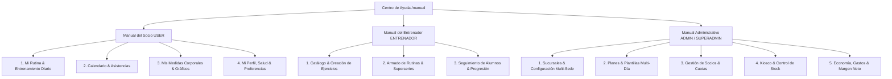

# Plan de Implementación: Manual de Usuario Interactivo en la App

> **Proyecto:** Meraki Gym — Centro de Entrenamiento  
> **Tipo:** Módulo de Ayuda y Documentación Interactiva Integrada (`/manual`)  
> **Destinatarios:** Socios (`USER`), Entrenadores (`ENTRENADOR`), Administradores (`ADMIN` / `SUPERADMIN`)  

---

## 1. Visión General y Objetivos

El objetivo es incorporar un **centro de ayuda y manual interactivo** dentro de la propia plataforma Meraki Gym, accesible en cualquier momento desde computadoras, tablets o smartphones (PWA).

### Objetivos Principales:
1. **Accesibilidad Contextual:** Permitir a cualquier usuario ingresar al manual desde el header, menú de usuario o accesos rápidos de ayuda (`?`).
2. **Segmentación por Rol:** El contenido se adapta al perfil autenticado (`USER`, `ENTRENADOR`, `ADMIN`/`SUPERADMIN`), abriendo por defecto la sección relevante pero permitiendo navegar entre módulos según permisos.
3. **Claridad Visual con Capturas y Ejemplos:** Cada funcionalidad clave contará con explicaciones claras, ejemplos de uso común, tarjetas de pasos ("Paso 1, 2, 3") y capturas de pantalla con visor ampliable (Lightbox).
4. **Optimización PWA y Responsive:** Diseñado con componentes modernos en Tailwind CSS, modo oscuro/claro y soporte offline para consulta en sala de entrenamiento.

---

## 2. Arquitectura de Rutas y Componentes

### 2.1. Rutas
- `/manual`: Redirige automáticamente al manual del rol del usuario actual o presenta un índice con selector de roles.
- `/manual/socio`: Manual para socios y atletas (Mi Rutina, Medidas, Calendario, Perfil).
- `/manual/entrenador`: Manual para profesores y entrenadores (Rutinas, Ejercicios, Alumnos).
- `/manual/admin`: Manual para administradores y dueños (Sucursales, Planes, Kiosco, Finanzas y Gastos).

### 2.2. Componentes UI a Desarrollar
- `ManualLayout`: Barra lateral de navegación con índice temático, indicador de lectura activa (Scrollspy/Anclas) y selector de rol.
- `ManualSearch`: Buscador reactivo en cliente con filtro rápido de temas y preguntas frecuentes (FAQ).
- `ScreenshotViewer` / `Lightbox`: Componente para visualizar capturas de pantalla con zoom, etiquetas indicadoras (hotspots con flechas/círculos numéricos) y subtítulos descriptivos.
- `StepCard`: Tarjetas numeradas tipo *"Paso a Paso"* con llamada a la acción y advertencias (tips/alertas).
- `HelpTrigger`: Botón flotante o enlace en el menú de navegación (`SiteHeader`) con ícono de salvavidas o interrogación (`?`).

---

## 3. Estructura y Contenido Detallado por Tipo de Usuario

### 3.1. Manual del Socio (`USER`)
| Sección | Contenidos y Ejemplos | Capturas de Pantalla Planificadas |
| :--- | :--- | :--- |
| **1. Primeros Pasos & Mi Perfil** | - Cómo completar la ficha de salud y autorizaciones médicas. - Configurar contactos de emergencia. - Seleccionar objetivos físicos. - Ajuste de foto con el detector facial interactivo. - Personalizar el tamaño de fuente y modo oscuro. | - Pantalla de `/perfil` con formulario de salud. - Detector facial recortando avatar. - Selector de fuente en header y slider. |
| **2. Mi Rutina Diaria** | - Cómo ver el día de entrenamiento asignado. - Modificar y guardar el peso levantado (kg) en tiempo real. - Marcar ejercicios completados y series. - Uso del temporizador de descanso con aviso sonoro. - Ver historial y gráfico de progreso de un ejercicio. | - Vista general de `/mi-rutina`. - Edición interactiva de peso y serie. - Temporizador flotante de descanso. - Gráfico de progresión de cargas. |
| **3. Calendario y Asistencias** | - Consulta de asistencias mensuales. - Días completados vs. días del plan. | - Calendario mensual con badges de días entrenados. |
| **4. Mis Medidas Corporales** | - Carga de peso corporal, cintura, bíceps. - Creación de métricas personalizadas (glúteos, etc.). - Interpretación de gráficos de evolución física. | - Formulario de nueva medición. - Gráfica de evolución en el tiempo. |

---

### 3.2. Manual del Entrenador (`ENTRENADOR`)
| Sección | Contenidos y Ejemplos | Capturas de Pantalla Planificadas |
| :--- | :--- | :--- |
| **1. Catálogo de Ejercicios** | - Cómo dar de alta un ejercicio con grupo muscular. - Carga de links de videos explicativos e instrucciones técnicas. - Filtrado rápido por grupo muscular (Pecho, Espalda, etc.). | - Grilla de `/admin/ejercicios`. - Modal de alta y edición de ejercicio. |
| **2. Creación y Edición de Rutinas** | - Armado de rutinas todo-en-uno en pantalla completa (`/admin/rutinas/nueva` y `/admin/rutinas/[id]`). - Selección de plan semanal que fija automáticamente los días de entrenamiento. - Configuración de series, repeticiones y descansos rápidos (60s, 90s, 120s). - Agrupación de ejercicios en Superseries / Circuitos (Grupos 1 al 10). - Duplicación rápida de rutinas completas en 1 clic desde el listado. | - Vista del editor todo-en-uno en `/admin/rutinas/nueva`. - Pestañas de días y configuración de superseries. |
| **3. Gestión y Asignación a Alumnos** | - Búsqueda de socios en el padrón. - Asignación de rutinas según los días del plan del alumno. - Monitoreo del historial de cargas del atleta. | - Padrón de `/admin/usuarios`. - Vista de asignación de días de entrenamiento. |

---

### 3.3. Manual del Administrador (`ADMIN` / `SUPERADMIN`)
| Sección | Contenidos y Ejemplos | Capturas de Pantalla Planificadas |
| :--- | :--- | :--- |
| **1. Sucursales & Configuración** | - Alta y mantenimiento de sucursales (dirección, redes, horarios). - Habilitación o bloqueo del módulo de Kiosco por sucursal (`tieneKiosco`). | - Listado de `/admin/sucursales`. - Formulario con toggle de kiosco. |
| **2. Planes y Plantillas Multi-Día** | - Creación de planes comerciales (días por semana y aranceles). - Armado de `PlanRutinaTemplate` para poblar rutinas completas en 1 clic. | - Vista `/admin/plan` y creación de templates. |
| **3. Padrón de Miembros y Cuotas** | - Alta de socios, asignación de sede y plan. - Tabla de control de pagos con menú contextual `...`. - Registro de cuota abonada y comprobante. | - Tabla de cobranzas en `/admin/economia`. - Menú de acciones contextuales por fila. |
| **4. Kiosco y Venta en Mostrador** | - Alta de productos con doble precio (`precioCompra` y `precioVenta`). - Control de stock y alerta de reposición urgente. - Venta rápida al paso o imputada a un socio. | - Inventario de `/admin/kiosco`. - Modal de registro de venta ágil. |
| **5. Economía, Gastos & Margen Neto** | - Alternancia entre Vista Global y Vista por Sucursal. - Carga de gastos operativos por categoría (Alquiler, Luz, Profesores, etc.). - Análisis del P&L en tiempo real (Ingresos vs Egresos = Margen Neto). - Exportación de reportes a Excel y PDF. | - Tarjetas de KPI e Ingresos vs Egresos en `/admin/economia`. - Modal de carga de gasto operativo. - Ejemplo de reporte exportado. |

---

## 4. Estrategia de Capturas y Recursos Gráficos

1. **Directorio Dedicado:** Las capturas y diagramas se almacenarán en `public/manual/`:
   - `/public/manual/socio/`
   - `/public/manual/entrenador/`
   - `/public/manual/admin/`
2. **Formato Optimizado:** Imágenes en formato WebP / PNG con compresión, marcos estilizados y modo oscuro/claro representativo.
3. **Hotspots Interactivos:** El componente `ScreenshotCard` permitirá superponer indicadores numéricos (①, ②, ③) que al pasar el cursor o pulsar explican el botón o sección señalada.

---

## 5. Fases de Ejecución Paso a Paso

### Fase 1: Estructura de Rutas y Layout Base
- Crear carpeta `src/app/manual/` con `layout.tsx`, `page.tsx` y subpáginas `socio/page.tsx`, `entrenador/page.tsx`, `admin/page.tsx`.
- Implementar barra lateral con navegación, buscador y selector de pestañas por rol.

### Fase 2: Componentes Reutilizables de Documentación
- Crear `ScreenshotCard.tsx` (con soporte para zoom modal / lightbox).
- Crear `StepGuide.tsx` (paso a paso numerado con íconos e indicadores).
- Crear `TipCallout.tsx` (alertas de información, tips de rendimiento y precauciones).

### Fase 3: Redacción del Contenido y Ejemplos de Uso
- Redactar los módulos completos para cada tipo de usuario con explicaciones precisas en español rioplatense (acorde al tono de la app).
- Agregar ejemplos de casos reales ("Cómo registrar un pago", "Cómo anotar el peso de sentadillas", etc.).

### Fase 4: Capturas de Pantalla y Recursos Visuales
- Tomar/generar las capturas de las secciones clave de la plataforma utilizando datos de prueba coherentes.
- Vincular las imágenes en cada sección del manual con sus leyendas explicativas.

### Fase 5: Integración en la Navegación Global
- Agregar enlace al **Manual de Ayuda** en `SiteHeader.tsx` (ícono `?` o en el menú de usuario).
- Añadir enlace en el menú de pie de página (`footer`) y en la pantalla de bienvenida.
- Validar permisos: redirección inteligente al manual del rol del usuario logueado.

### Fase 6: Verificación y Pruebas
- Verificación de tipos TypeScript (`npx tsc --noEmit`).
- Pruebas de navegación en dispositivos móviles, tablets y desktop.
- Verificación del comportamiento sin conexión (PWA Service Worker).
