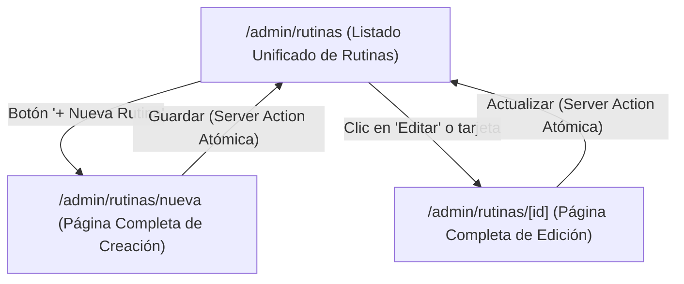
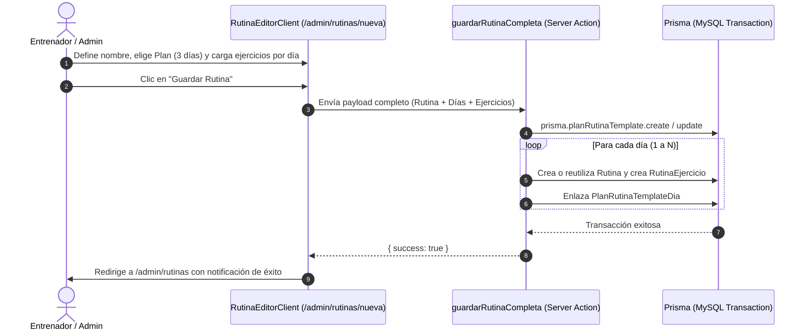

# Plan de Implementación: Simplificación del Módulo de Rutinas (`/admin/rutinas`)

> **Objetivo:** Transformar la experiencia de entrenadores y administradores para que la creación y edición de rutinas sea 100% intuitiva, eliminando la distinción técnica entre "rutinas por día" y "multi-día", reemplazando los modales por páginas dedicadas (`/admin/rutinas/nueva` y `/admin/rutinas/[id]`), y permitiendo cargar todos los ejercicios de cada día en una sola pantalla sin salir.

---

## 1. Diagnóstico y Problemas Actuales

| Situación Actual | Problema para el Entrenador / Admin | Solución Propuesta |
| :--- | :--- | :--- |
| **Dos pestañas separadas:** "Plantillas Multi-Día" y "Catálogo Diario". | Confuso: un entrenador solo quiere armar una "Rutina" con sus días correspondientes, no entender cómo se estructuran las tablas en la base de datos. | **Una sola vista unificada de "Rutinas"**. Se oculta la complejidad técnica y se presenta la rutina completa como la unidad de trabajo. |
| **Carga mediante Modales:** La creación se realiza en modales flotantes pequeños. | Espacio reducido para ver ejercicios, series, repeticiones y superseries. Incómodo para armar entrenamientos completos. | **Páginas dedicadas de pantalla completa:** `/admin/rutinas/nueva` y `/admin/rutinas/[id]`. |
| **Flujo fragmentado en varios pasos:** Para crear una rutina de 3 días, primero hay que salir al catálogo diario, crear Día 1, guardar, crear Día 2, guardar, crear Día 3, guardar, y luego volver a plantillas a vincularlas. | Fricción extrema y pérdida de tiempo. Si falta una rutina diaria, hay que abandonar el formulario. | **Editor Todo-en-Uno en una sola página:** En la misma pantalla se configuran el nombre, plan y cada día (Día 1, Día 2, etc.), cargando los ejercicios en línea o eligiendo uno existente con 1 clic. |

---

## 2. Arquitectura de Navegación y Rutas

### Rutas a Implementar:
1. `/admin/rutinas`: Vista principal unificada. Muestra el catálogo de **Rutinas** (con su plan, resumen de días, cantidad de ejercicios y estado), buscador, filtro por frecuencia de días y botón principal `+ Nueva Rutina`.
2. `/admin/rutinas/nueva`: Página dedicada de pantalla completa para crear una nueva rutina desde cero.
3. `/admin/rutinas/[id]`: Página dedicada para editar una rutina existente con todos sus días y ejercicios precargados.

---

## 3. Diseño del Editor Todo-en-Uno (`RutinaEditorClient`)

En una única página sin recargas ni modales, el entrenador tendrá 3 bloques organizados:

### Bloque A: Información General de la Rutina
- **Nombre de la Rutina:** Ej. *"Fuerza e Hipertrofia 3 Días"*, *"Principiantes Adaptación"*.
- **Plan / Frecuencia Semanal:** Selector de Plan comercial (*"Plan 2 Días"*, *"Plan 3 Días"*, *"Plan 4 Días"*, etc.). Al cambiar el plan, el editor ajusta automáticamente la cantidad de días requeridos (1 a 7).
- **Descripción / Objetivo:** Campo opcional para notas metodológicas (ej. *"Rutina enfocada en torso/pierna para atletas intermedios"*).
- **Estado:** Interruptor Activo / Inactivo.

### Bloque B: Constructor Multi-Día (Pestañas de Días)
Una barra horizontal de días: `[Día 1: Pecho y Bíceps]` `[Día 2: Piernas]` `[Día 3: Espalda y Hombros]` ...
Al seleccionar un día, se muestra su panel de configuración:

1. **Encabezado del Día:**
   - Nombre legible del día (ej. *"Día 1 - Pecho y Bíceps"*).
   - Acceso rápido: *"¿Querés partir de una rutina ya existente?"* (Dropdown que precarga los ejercicios de una rutina del catálogo en este día para editarlos o usarlos como base).
2. **Selector de Ejercicios en Línea:**
   - Buscador rápido con filtro de grupo muscular (Pecho, Espalda, Piernas, etc.).
   - Al hacer clic en un ejercicio, se añade instantáneamente a la grilla de ese día.
3. **Grilla Interactiva de Ejercicios del Día:**
   - **Ejercicio:** Nombre y grupo muscular.
   - **Series:** Input numérico (ej. `4`).
   - **Repeticiones:** Texto flexible (ej. `10-12`, `Fallo`, `15`).
   - **Pausa / Descanso:** Segundos con botones rápidos (`60s`, `90s`, `120s`).
   - **Peso Sugerido (kg):** Carga de referencia inicial para el socio.
   - **Superseries / Circuito:** Selector de grupo (*"Individual"*, *"Grupo 1"*, *"Grupo 2"*...).
   - **Notas:** Indicaciones técnicas breves.
   - **Reordenar / Eliminar:** Flechas para subir/bajar orden y botón de remover.

### Bloque C: Barra de Acción Fija
- Botón **"Cancelar"** (regresa a `/admin/rutinas` con confirmación si hay cambios sin guardar).
- Botón principal **"Guardar Rutina"** (con spinner de carga y validación visual inmediata).

---

## 4. Persistencia y Compatibilidad con la Base de Datos

Para que la base de datos y los módulos existentes (`/admin/usuarios`, `/mi-rutina`, etc.) sigan funcionando de forma 100% transparente sin migraciones complejas:

1. **`guardarRutinaCompleta` (Server Action Unificada):**
   - Recibe la rutina general y el arreglo de días con sus respectivos ejercicios.
   - Ejecuta una transacción atómica con `enTransaccion` de Prisma.
   - Si el día utilizó una rutina existente sin modificaciones, la asocia directamente.
   - Si el día armó o editó ejercicios personalizados, genera una `Rutina` interna vinculada con sus `RutinaEjercicio` y la asocia a `PlanRutinaTemplateDia`.
2. **Retrocompatibilidad Total:**
   - La asignación de rutinas en `/admin/usuarios` sigue utilizando `PlanRutinaTemplate` y sus días, por lo que los atletas no sufrirán ningún cambio en su visualización de `/mi-rutina`.
   - Las rutinas creadas previamente seguirán disponibles y visibles en el nuevo listado.

---

## 5. Fases de Ejecución Paso a Paso

### Fase 1: Server Actions y Lógica de Datos
- Crear la Server Action `guardarRutinaCompleta` en `src/app/admin/rutinas/actions.ts`:
  - Soporte de creación y actualización atómica en una única transacción.
  - Validación de nombres, plan seleccionado y al menos 1 ejercicio por día.
- Crear la Server Action `getRutinaCompletaParaEditar(id: number)`:
  - Recupera la plantilla con sus días y todos sus ejercicios desglosados listos para poblar el editor.

### Fase 2: Componente `RutinaEditorClient` y Subcomponentes
- Desarrollar `src/app/admin/rutinas/RutinaEditorClient.tsx`:
  - Manejo de estado de la rutina (nombre, plan, días, ejercicios).
  - Pestañas reactivas de navegación entre días.
  - Subcomponente de grilla de ejercicios con edición ágil de series, repeticiones, descansos y superseries.
  - Buscador rápido de ejercicios con filtros por grupo muscular.

### Fase 3: Páginas Dedicadas
- Crear `src/app/admin/rutinas/nueva/page.tsx`:
  - Carga selectores de planes y ejercicios.
  - Renderiza `RutinaEditorClient` en modo creación.
- Crear `src/app/admin/rutinas/[id]/page.tsx`:
  - Carga la rutina completa mediante `getRutinaCompletaParaEditar(id)`.
  - Renderiza `RutinaEditorClient` en modo edición.

### Fase 4: Rediseño de la Vista Principal `/admin/rutinas`
- Modificar `src/app/admin/rutinas/page.tsx` y `src/app/admin/rutinas/RutinasClient.tsx`:
  - Eliminar la barra de pestañas "Plantillas Multi-Día" vs "Catálogo Diario".
  - Mostrar una única tabla clara de **Rutinas**.
  - El botón `+ Nueva Rutina` ahora navega directamente a `/admin/rutinas/nueva`.
  - El botón `Editar` navega a `/admin/rutinas/[id]`.
  - Mantener acciones rápidas: duplicar rutina, activar/desactivar y eliminar.

### Fase 5: Pruebas, Verificación y TypeScript
- Verificar compilación completa con `npx tsc --noEmit`.
- Validar flujo completo de creación de rutina de 3 días con ejercicios nuevos y guardado exitoso.
- Validar flujo de edición y actualización de ejercicios existentes.
- Probar responsividad en dispositivos móviles y tablets.
