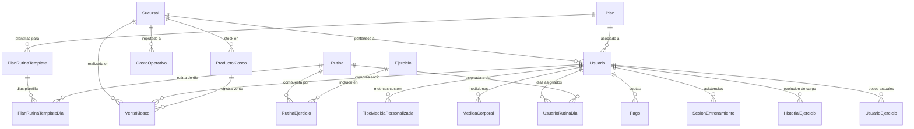

# Gimnasio Meraki — Especificaciones Técnicas y Funcionales del Sistema

> **Documento de Especificación Oficial**  
> **Versión:** 2.0  
> **Estado:** Aprobado / Actualizado  
> **Última Actualización:** 2026-11-15  

---

## Índice

1. [Visión General y Propósito del Sistema](#1-visión-general-y-propósito-del-sistema)
2. [Arquitectura Tecnológica y Stack](#2-arquitectura-tecnológica-y-stack)
3. [Modelo de Roles, Permisos y Seguridad](#3-modelo-de-roles-permisos-y-seguridad)
4. [Modelo de Datos y Entidades Principales](#4-modelo-de-datos-y-entidades-principales)
5. [Módulos y Funcionalidades del Sistema](#5-módulos-y-funcionalidades-del-sistema)
   - 5.1. [Gestión de Sucursales (Multi-sede)](#51-gestión-de-sucursales-multi-sede)
   - 5.2. [Gestión de Usuarios y Ficha Integral del Socio](#52-gestión-de-usuarios-y-ficha-integral-del-socio)
   - 5.3. [Gestión de Planes, Rutinas y Ejercicios](#53-gestión-de-planes-rutinas-y-ejercicios)
   - 5.4. [Experiencia del Socio: Mi Rutina, Asistencia y Progreso](#54-experiencia-del-socio-mi-rutina-asistencia-y-progreso)
   - 5.5. [Seguimiento Físico y Medidas Corporales](#55-seguimiento-físico-y-medidas-corporales)
   - 5.6. [Kiosco y Ventas en Mostrador](#56-kiosco-y-ventas-en-mostrador)
   - 5.7. [Módulo Económico, Gastos Operativos y Margen Neto](#57-módulo-económico-gastos-operativos-y-margen-neto)
   - 5.8. [Pagos, Cobranzas e Integración Mercado Pago](#58-pagos-cobranzas-e-integración-mercado-pago)
   - 5.9. [Accesibilidad, Preferencias Visuales y Tipografía Global](#59-accesibilidad-preferencias-visuales-y-tipografía-global)
   - 5.10. [PWA, Multimedia y Biometría Facial](#510-pwa-multimedia-y-biometría-facial)
6. [Estructura de Navegación y Rutas](#6-estructura-de-navegación-y-rutas)
7. [Estándares de Rendimiento, Resiliencia y Datos](#7-estándares-de-rendimiento-resiliencia-y-datos)

---

## 1. Visión General y Propósito del Sistema

**Gym Meraki** es una plataforma web progresiva (PWA) de alto rendimiento orientada a la gestión integral y operativa de centros de entrenamiento y gimnasios, con soporte multi-sucursal y personalización para atletas.

### Objetivos Clave
- **Gestión Multi-sucursal:** Administración centralizada de sedes (horarios, ubicación, contacto, redes y habilitación de módulos), con balance financiero consolidado y desagregado por sucursal.
- **Ficha Integral del Socio:** Alta y edición rápida de miembros con datos biomédicos (salud, medicación, restricciones, autorización médica), contacto de emergencia y objetivos físicos personalizados.
- **Rutinas Adaptativas y Progresión de Cargas:** Asignación de rutinas por día de entrenamiento (1 a 7 días), plantillas multi-día, registro de pesos en tiempo real, descansos con temporizador y gráficos de evolución histórica de fuerza.
- **Control Económico en Tiempo Real:** Cálculo automático del margen neto del gimnasio: **Ingresos por Cuotas + Ganancia de Ventas de Mostrador - Gastos Operativos**, con exportación contable a Excel y PDF.
- **Kiosco / Punto de Venta en Mostrador:** Control de inventario de bebidas, suplementos y snacks por sucursal, con precios de compra, venta, umbrales de reposición y margen unitario.
- **Autonomía del Atleta (PWA Mobile-First):** Interfaz táctil pensada para uso en sala de pesas, soporte sin conexión básica mediante Service Worker y herramientas de accesibilidad visual directa.

---

## 2. Arquitectura Tecnológica y Stack

### 2.1. Núcleo de Aplicación
- **Framework:** Next.js 16.1.6 (App Router con React Server Components y Server Actions).
- **Librería de Interfaz:** React 19.2.3.
- **Lenguaje:** TypeScript 5.8.3 en modo estricto.
- **Motor de Estilos:** Tailwind CSS 4.2.1 junto con un sistema de variables semánticas (`app/globals.css`) para soporte nativo de modo claro y oscuro.
- **Entorno de Ejecución:** Node.js `>= 20.19.0`.

### 2.2. Persistencia y Base de Datos
- **Motor de Base de Datos:** MySQL / MariaDB.
- **ORM:** Prisma 7.9.1.
  - Driver adapter: `@prisma/adapter-mariadb`.
  - Generador de cliente compilado: `prisma-client` localizado en `lib/generated/prisma`.
  - Configuración desacoplada en `prisma.config.ts`.
  - Transacciones y auditoría mediante helper `enTransaccion()` (`lib/prisma.ts`).

### 2.3. Autenticación, Sesión y Seguridad
- **Mecanismo de Sesión:** Stateless Session mediante JWT (`jose` 6.0.12) firmado con `HS256`, persistido en cookie HTTP-Only con validez de 7 días, flag `SameSite: Lax` y protección CSRF nativa de Server Actions.
- **Almacenamiento de Credenciales:** Hasheo criptográfico mediante `bcryptjs` 3.0.2 con factor de salting seguro.

### 2.4. Inteligencia Artificial y Procesamiento Multimedia
- **Detección Facial en Navegador:** `@tensorflow/tfjs` 4.22.0 y `face-api.js` 0.22.2 (`AvatarCropper.tsx`) para centrado automático del rostro, zoom interactivo y recorte de avatares en canvas HTML5.
- **Validación Binaria de Imágenes:** Comprobación estricta de "magic numbers" (PNG `0x89 0x50 0x4E 0x47` y JPEG `0xFF 0xD8 0xFF`) con tope de 1 MB en `lib/imagenes-perfil.ts` para mitigar ataques de spoofing MIME.
- **Almacenamiento Protegido:** Archivos fotográficos alojados fuera de `public/` en `var/uploads/users/<id>/`, servidos mediante Route Handler autenticado (`app/api/imagenes/perfil/[imagenId]/[variante]/route.ts`).

### 2.5. PWA (Progressive Web App)
- Service Worker nativo (`lib/service-worker.ts`), manifiesto dinámico (`app/manifest.ts`), banner de instalación `InstallPrompt` y soporte de standalone cover en dispositivos móviles.

---

## 3. Modelo de Roles, Permisos y Seguridad

El sistema implementa un modelo de control de acceso basado en roles (RBAC) con 4 niveles:

| Rol | Alcance y Facultades |
| :--- | :--- |
| **`USER`** | Socio/Atleta del gimnasio. Acceso a **Mi Rutina**, registro de peso levantado, cronómetro de descanso, **Calendario de Asistencia**, seguimiento de **Mis Medidas** corporales y edición de **Mi Perfil** (salud, emergencias, objetivos, foto de perfil y escala de fuentes). |
| **`ENTRENADOR`** | Personal técnico. Acceso a la gestión de **Rutinas**, **Ejercicios**, plantillas de entrenamiento y consulta/asignación sobre el padrón de **Usuarios**. Sin acceso a balances financieros, planes comerciales ni kiosco. |
| **`ADMIN`** | Administrador de sede/gimnasio. Control operativo y comercial total: gestión de miembros, asignación de planes, control de pagos, administración de sucursales, kiosco/mostrador y registro de gastos operativos y balance neto. |
| **`SUPERADMIN`** | Operador global de la plataforma. Acceso irrestricto a todas las funcionalidades, configuración transversal y mantenimiento global de todas las sedes. |

---

## 4. Modelo de Datos y Entidades Principales

El esquema relacional implementado en Prisma (`prisma/schema.prisma`) estructura el negocio en los siguientes modelos centrales:

### Entidades Destacadas
1. **`Sucursal`:** Identificador, teléfono, dirección, barrio, imagen, Instagram, TikTok, horarios en texto, estado activo y flag `tieneKiosco`.
2. **`Usuario`:** Credenciales, datos personales (DNI, teléfono, dirección, fecha de nacimiento, fotos), rol, sucursal asignada y plan contratado.
   - *Sección Salud:* `tieneLesion`, `detalleLesion`, `tomaMedicacion`, `detalleMedicacion`, `tieneRestricciones`, `detalleRestricciones`, `autorizadoPorMedico`, `observacionesSalud`.
   - *Sección Emergencia:* `emergenciaContacto`, `emergenciaParentesco`, `emergenciaTelefono`.
   - *Sección Objetivos:* `objetivos` (JSON de objetivos seleccionados) y `objetivoOtro`.
3. **`Plan` y `PlanRutinaTemplate`:** Definición de membresía por días por semana (1 a 7 días) y plantillas preconfiguradas multi-día para clonación ágil a socios nuevos.
4. **`Rutina` y `Ejercicio`:** Catálogo de ejercicios clasificados por grupo muscular con fotos/videos y rutinas con asignación de series, repeticiones, descansos, pesos sugeridos y grupos de superseries/circuitos.
5. **`SesionEntrenamiento` e `HistorialEjercicio`:** Auditoría de asistencia a entrenamientos, porcentaje completado y series/pesos logrados por ejercicio con timestamp.
6. **`MedidaCorporal` y `TipoMedidaPersonalizada`:** Registro histórico de métricas corporales estándar (peso, cintura, bíceps, etc.) o creadas dinámicamente por el atleta.
7. **`ProductoKiosco` y `VentaKiosco`:** Artículos de mostrador con doble precio (`precioCompra` y `precioVenta`), inventario por sucursal y registro de transacciones con cálculo de costo, venta y margen neto unitario.
8. **`GastoOperativo`:** Egresos de sucursal clasificados por categoría (Alquiler, Profesores, Luz, Mantenimiento, etc.), recurrencia y método de pago para el estado de resultados.
9. **`Pago`:** Registro de cobranzas de cuotas mensuales por socio con fecha, monto, método de pago y comprobante adjunto.

---

## 5. Módulos y Funcionalidades del Sistema

### 5.1. Gestión de Sucursales (Multi-sede)
- **Ruta:** `/admin/sucursales`
- **Capacidades:**
  - Alta, baja lógica y edición de sucursales con dirección, barrio, horarios detallados y enlaces a redes sociales (Instagram y TikTok).
  - Configuración del flag `tieneKiosco` que habilita o deshabilita la sección de ventas rápidas para cada sede en particular.
  - Asociación estricta 1:N entre socios y sucursal.
  - Vistas económicas con filtro selector por sucursal y consolidado global.

### 5.2. Gestión de Usuarios y Ficha Integral del Socio
- **Rutas:** `/admin/usuarios` y `/perfil`
- **Capacidades:**
  - Padrón general con filtros por rol, estado y búsqueda reactiva por nombre, apellido, DNI o teléfono.
  - Asignación de plan de entrenamiento (1 a 7 días) y sucursal de pertenencia.
  - **Ficha de Salud y Aptitud Física:**
    - Cuestionario de lesiones o condiciones médicas preexistentes con descripción de detalle.
    - Registro de ingesta de medicación crónica o temporal.
    - Declaración de restricciones físicas recomendadas por especialistas.
    - Checkbox de autorización médica formal para práctica de actividad física de alta exigencia.
    - Campo abierto de observaciones médicas relevantes.
  - **Datos de Contacto de Emergencia:**
    - Nombre del contacto directo, parentesco/vínculo y teléfono de urgencia.
  - **Objetivos de Entrenamiento Multiselección:**
    - Opciones seleccionables en simultáneo: *Bajar de peso*, *Aumentar masa muscular*, *Mejorar condición física*, *Rendimiento deportivo*, *Rehabilitación*, *Salud y bienestar* y *Otro* (con especificación en texto libre).
  - **Gestión de Avatar:** Recorte inteligente con detector de rostros (`AvatarCropper`) y almacenamiento seguro con validación binaria de formato.

### 5.3. Gestión de Planes, Rutinas y Ejercicios
- **Rutas:** `/admin/plan`, `/admin/rutinas`, `/admin/ejercicios`
- **Capacidades:**
  - **ABM de Ejercicios:** Alta con grupo muscular (Pecho, Espalda, Piernas, Hombros, Brazos, Core, etc.), instrucciones técnicas, multimedia (imágenes y videos explicativos).
  - **ABM de Rutinas y Templates:** Creación de rutinas reutilizables con ordenamiento de ejercicios, configuración de series, repeticiones (fijas o al fallo), pausas en segundos, peso de referencia y asignación a grupos (superseries).
  - **Plantillas Multi-Día (`PlanRutinaTemplate`):** Vinculación de rutinas prearmadas para los días de un plan (ej: "Hipertrofia 4 días"), permitiendo poblar la rutina completa de un socio nuevo en un solo clic.

### 5.4. Experiencia del Socio: Mi Rutina, Asistencia y Progreso
- **Rutas:** `/mi-rutina` y `/calendario`
- **Capacidades:**
  - Visualización del día activo según el plan contratado con listado de ejercicios y superseries agrupadas.
  - Marcado en tiempo real de ejercicios completados y ajuste interactivo del peso de trabajo utilizado en la sesión.
  - Temporizador flotante de descanso entre series con notificación auditiva/visual.
  - Gráficos de progresión histórica de carga por ejercicio para evaluar sobrecarga progresiva.
  - **Calendario:** Registro interactivo de asistencias mensuales y sesiones realizadas.

### 5.5. Seguimiento Físico y Medidas Corporales
- **Ruta:** `/mis-medidas`
- **Capacidades:**
  - Registro de mediciones periódicas tanto de tipos estándar (peso corporal en kg, cintura en cm, bíceps, muslo, pecho) como de tipos personalizados creados por el propio atleta (glúteos, pantorrilla, pliegues cutáneos).
  - Gráficos de dispersión y tendencia temporal para evaluar la transformación física a lo largo de las semanas.

### 5.6. Kiosco y Ventas en Mostrador
- **Ruta:** `/admin/kiosco`
- **Capacidades:**
  - Inventario de productos segmentado por sucursal con categoría (Bebidas, Suplementos, Snacks, Indumentaria, Accesorios).
  - Gestión de costos y márgenes: carga de `precioCompra` y `precioVenta` unitarios con cálculo automático de rentabilidad.
  - Control de stock físico y definición de `stockMinimo` con alerta visual de reposición urgente.
  - Registro ágil de ventas en mostrador con selector opcional de socio comprador (permite venta al paso anónima), deducción de inventario en tiempo real y registro del método de pago (Efectivo, Transferencia, Mercado Pago, Débito).
  - Bloqueo o habilitación condicional del módulo según la sucursal seleccionada.

### 5.7. Módulo Económico, Gastos Operativos y Margen Neto
- **Ruta:** `/admin/economia`
- **Capacidades:**
  - **Selector de Ámbito:** Alternancia instantánea entre *Vista Global (Todas las sucursales)* y vista individual por cada sucursal física.
  - **Estado de Resultados (P&L) en Tiempo Real:**
    - **Ingresos Totales:** Cuotas de socios cobradas + Ventas brutas del kiosco.
    - **Egresos y Costos:** Costo de mercadería vendida (CMV del kiosco) + Gastos operativos del período.
    - **Margen Neto Real:** Beneficio real de la operación en pesos (`Ingresos - Egresos`), margen porcentual y ticket promedio.
  - **Gestión de Gastos Operativos (`GastoOperativo`):**
    - Carga de gastos por concepto y categoría (*Alquiler*, *Honorarios Profesores*, *Luz y Servicios*, *Reposición de Máquinas*, *Limpieza e Insumos*, *Impuestos*, *Marketing*, *Otros*).
    - Soporte para gastos fijos mensuales recurrentes y comprobantes de pago.
  - **Control de Pagos de Socios:**
    - Grilla mensual de cuotas con buscador, estado de pago (Al día / Pendiente / Vencido), monto y fecha.
    - Menú de acciones contextual por fila (`...`) para registrar cobro, editar importe, adjuntar comprobante o ver ficha.
    - Eliminación de avatares redundantes para maximizar espacio útil en pantallas compactas.
  - **Exportación Contable:** Generación y descarga directa en formatos **Excel (`.xlsx`)** y **PDF** con el detalle financiero mensual de ingresos, gastos y margen neto.

### 5.8. Pagos, Cobranzas e Integración Mercado Pago
- **Rutas:** `/api/mercadopago/checkout-demo` y `/api/mercadopago/webhook`
- **Capacidades:**
  - Generación de preferencias de pago automáticas para suscripciones y membresías.
  - Procesamiento asíncrono de eventos mediante Webhook oficial con validación de estado de transacción (`approved`, `pending`, `rejected`) e imputación automática al modelo `Pago`.

### 5.9. Accesibilidad, Preferencias Visuales y Tipografía Global
- **Componentes:** `FontSizeSelector.tsx`, `PreferenciasVisuales.tsx`, `useFontSize.ts` y `SiteHeader.tsx`
- **Capacidades:**
  - **Selector en Encabezado:** Ícono tipográfico situado junto al selector de tema (día/noche) tanto en la barra de navegación Desktop como en el menú Mobile.
  - **Escala de Tamaños Homologada:** Opciones estandarizadas en:
    - **90%** (Reducido)
    - **100%** (Estándar / Predeterminado)
    - **105%** (Cómodo)
    - **110%** (Medio)
    - **120%** (Aumentado)
    - **150%** (Grande)
  - **Sincronización Bidireccional:** El control desplegable del header y el slider de `/perfil` (`PreferenciasVisuales.tsx`) comparten el hook reactivo `useFontSize`, persistiendo la elección en `localStorage` (`gym-font-size`) y aplicando la transformación vía `document.documentElement.style.fontSize` sin desajustes de hidratación (FOUC).

### 5.10. PWA, Multimedia y Biometría Facial
- Soporte para instalación como aplicación web de escritorio y móvil (iOS / Android).
- Reconocimiento de marcos faciales previo a la carga de avatares para garantizar encuadres uniformes en los carnets digitales.
- Caché estática y comportamiento offline básico para consulta de rutinas guardadas en memoria.

---

## 6. Estructura de Navegación y Rutas

### 6.1. Portal del Atleta (`USER`)
- `/`: Portada con resumen rápido del día, acceso al entrenamiento y métricas del socio.
- `/mi-rutina`: Interfaz activa de entrenamiento diario, series, repeticiones, cargas y cronómetro.
- `/calendario`: Registro y visualización mensual de asistencias al gimnasio.
- `/mis-medidas`: Registro y analítica gráfica de medidas corporales y evolución física.
- `/perfil`: Ficha médica, datos de emergencia, objetivos personales, foto de perfil y escala de fuente.

### 6.2. Portal del Entrenador (`ENTRENADOR`)
- `/admin/rutinas`: Catálogo, creación y edición de rutinas y superseries.
- `/admin/ejercicios`: Base de datos de ejercicios con técnica, grupo muscular y multimedia.
- `/admin/usuarios`: Consulta del padrón de alumnos, asignación de rutinas y seguimiento de cargas.

### 6.3. Portal Administrativo (`ADMIN` / `SUPERADMIN`)
- `/admin/usuarios`: Gestión de socios, altas, bajas, asignación de sedes y planes.
- `/admin/sucursales`: Administración física de sedes, datos de contacto, horarios y toggles de kiosco.
- `/admin/plan`: Configuración de planes por días a la semana (1 a 7) y aranceles.
- `/admin/kiosco`: Catálogo de mostrador, control de existencias, precios de compra/venta y registro de ventas.
- `/admin/economia`: P&L consolidado y por sede, control mensual de cuotas, carga de gastos operativos y exportación a Excel/PDF.

### 6.4. Endpoints de API y Servicios del Backend
- `/api/imagenes/perfil/[imagenId]/[variante]`: Servido protegido de avatares y fotografías de perfil.
- `/api/mercadopago/checkout-demo`: Creación de preferencias de pago online.
- `/api/mercadopago/webhook`: Receptor y conciliador de notificaciones de pago de Mercado Pago.

---

## 7. Estándares de Rendimiento, Resiliencia y Datos

1. **Mutaciones Atómicas:** Todas las operaciones que involucran movimientos contables (ventas de kiosco con baja de stock, pagos de cuotas y registros de gastos) se ejecutan dentro del wrapper transaccional `enTransaccion()` de Prisma para garantizar integridad referencial estricta.
2. **Server Actions First:** Toda la lógica de negocio y mutación se canaliza mediante Next.js Server Actions con revalidación de caché bajo demanda (`revalidatePath`), prescindiendo de APIs REST secundarias innecesarias.
3. **Optimización de Interfaz y Tipografía:** La carga de fuentes y estilos se inicializa en el `<head>` del layout raíz para neutralizar parpadeos visuales al cambiar de tamaño o tema.
4. **Respeto a la Privacidad Médica:** La información de salud y contacto de emergencia del socio está restringida exclusivamente al atleta y a los administradores autorizados para soporte ante incidentes en el gimnasio.
